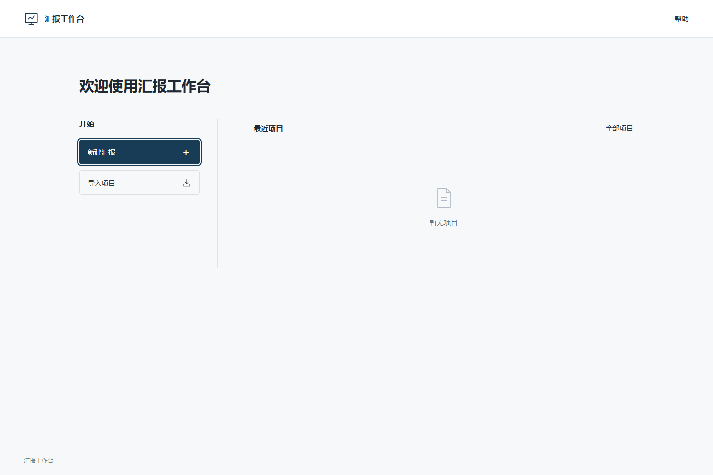
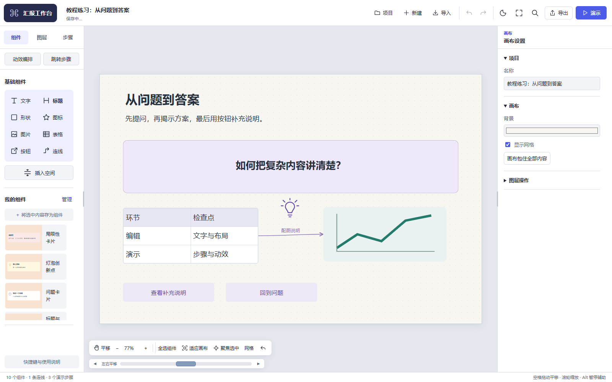
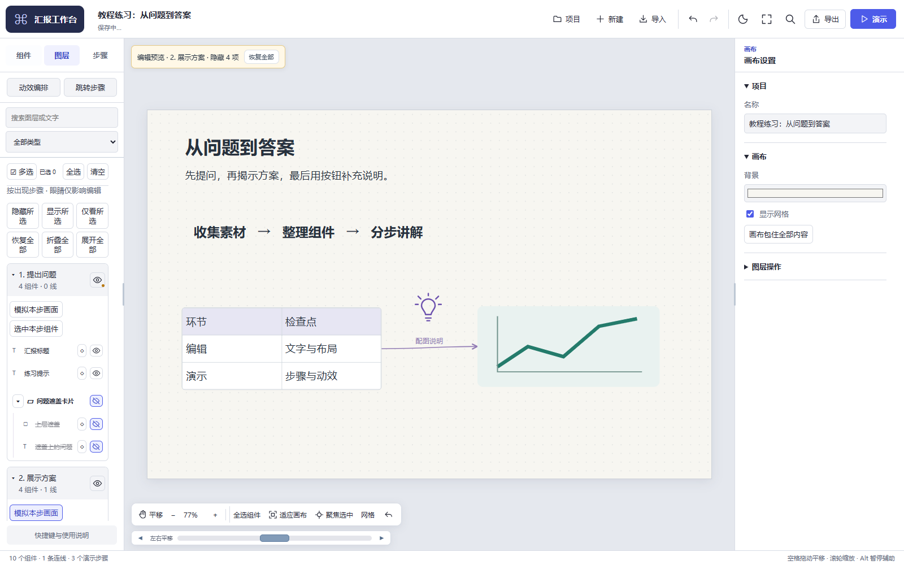
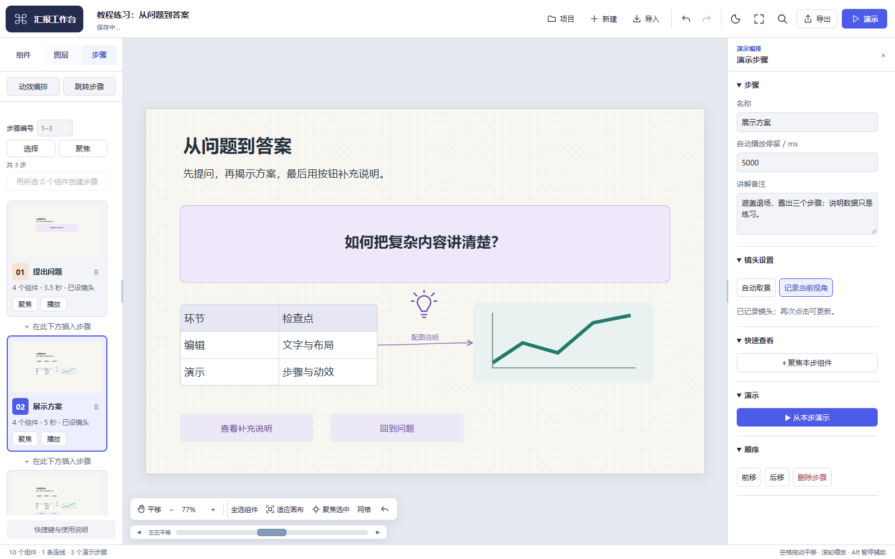
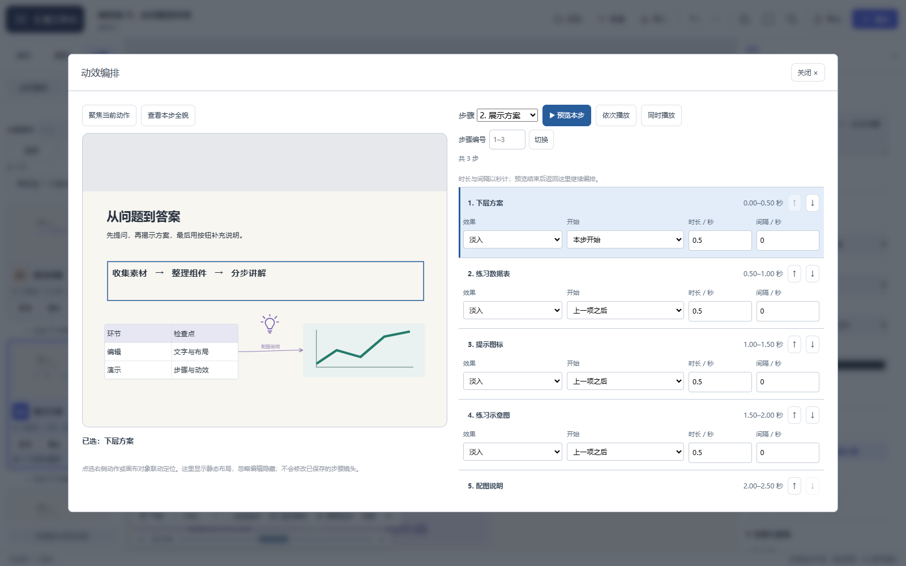
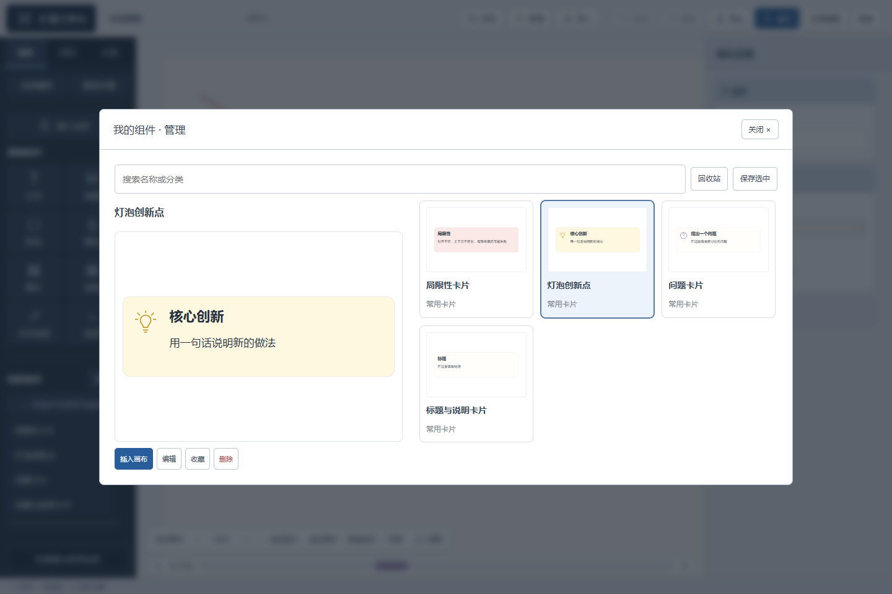
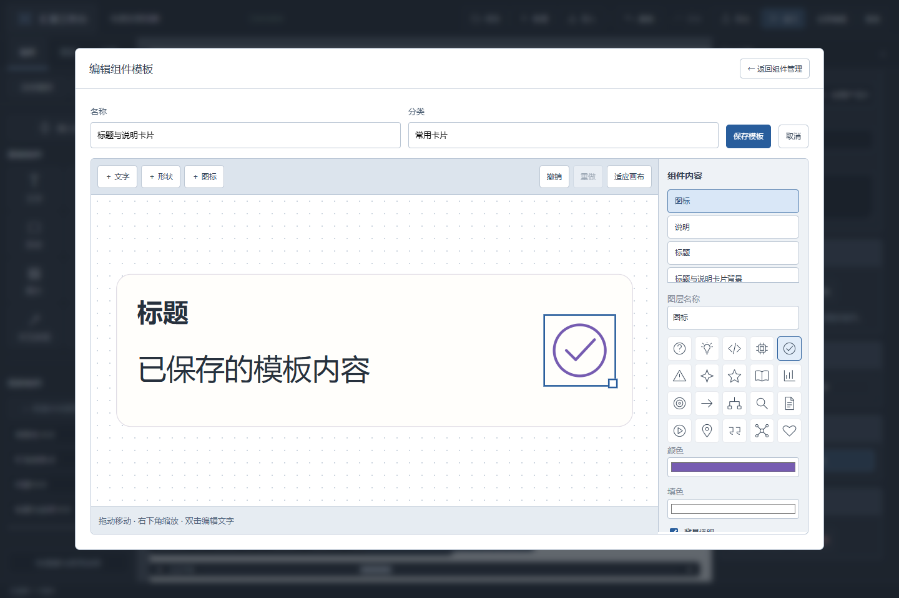

# 汇报工作台用户使用教程

适用版本：Windows 桌面版 1.10.0，以及由该版本导出的 HTML 工作台。更新日期：2026 年 11 月 16 日。

这份教程带你完成一份可编辑、可逐步播放、可点击交互的汇报。第一次使用，先读第 1—3 章；遇到具体问题，可按目录跳转，或在网页版搜索“隐藏”“镜头”“图片”“保存”等关键词。

## 1 先理解工作台的三个概念

**画布是摆放内容的空间。** 它可以很长、很宽，不必每讲一段就建立一张固定大小的幻灯片。你可以把整套逻辑放在同一画布上，再在演示时切换关注区域。

**组件是可以单独修改的对象。** 文字、形状、图标、图片、表格和按钮都可以移动、缩放、复制。标题也是文字组件；组合卡片是多个组件放在一起，并非不可拆开的图片。

**步骤决定什么时候出现、什么时候退场，以及观众看哪里。** 默认情况下，前一步出现的内容会继续保留。只有设置了退场步骤，内容才会从相应步骤开始消失。镜头只改变视野，不决定组件是否出现。

例如：“提出问题 → 展示方案 → 结论与互动”可以使用同一画布。问题卡片在第 1 步出现、第 2 步退场；下面的方案在第 2 步出现；按钮在第 3 步出现。

工作台适合流程图、研究汇报、概念关系、长画布讲解与带交互的演示。当前没有 PPTX 导入导出，也没有完整多轨时间轴或运动路径编辑器。

## 2 打开应用并认识界面

桌面版打开后自动最大化窗口，保留标题栏和右上角的最小化、还原、关闭按钮。需要还原窗口时，点击系统按钮即可。F11或演示栏“全屏”是另外的主动全屏操作；浏览器HTML也不会自动进入全屏。

### 启动和建立项目

1. 使用桌面上原有的“汇报工作台”快捷方式，或运行 `D:\PresentationStudio\汇报工作台.exe`。
2. 在欢迎页点击“新建汇报”，输入项目名称。
3. 点击“创建”，进入空白画布；已有文件可点“导入项目”，继续之前的工作可点“最近项目”。
4. 在顶部项目名称框中随时重命名。观察旁边保存状态，确认显示“已自动保存”。

欢迎页不会自动载入示例，也不会生成空白项目。进入编辑后，点击左上角深色“汇报工作台”卡片的图标或文字，会保存当前内容并返回最近项目列表。当前没有自动教程引导。

本机使用时不需要安装 Python、Node，也不需要联网。不要只把 exe 单独拷走；程序需要同目录中的其他文件。

### 调整边栏与展开属性

拖动左右边栏靠近画布的边线即可调整宽度。左栏范围190–360像素，右栏260–420像素；窗口变窄时会自动收窄，属性栏在窄窗口中覆盖显示。宽度会在本机记住，不改变项目内容。双击边线恢复默认（左220、右300像素）；按Tab聚焦边线后，左右方向键微调，Shift加速，Home恢复默认。拖动时按Esc取消。

右侧先显示所选组件的内容与排版。点击分组标题展开或收起外观、动效、点击交互、图层操作等设置；切换对象时保留本次会话的展开状态。出现和退场归“出现与退场”，进入效果和时间归“动效”。网格/对象吸附、拖入连线和导图快捷键默认开启，不再显示开关；按住Alt临时跳过。Tab/Enter仅在画布焦点且单选时创建分支，输入框Tab仍导航。

### 常用区域

| 区域 | 用途 |
| --- | --- |
| 顶部 | 项目管理、新建、导入、撤销、重做、导出、演示、搜索 |
| 左侧“组件” | 添加对象、组合卡片、连线；向下或向右插入空间 |
| 左侧“图层” | 按出现步骤查找对象、折叠分组、控制编辑可见性 |
| 左侧“步骤” | 添加、排序、选择和播放步骤 |
| 左侧工具区 | 动效编排、拖入连线开关、导图快捷键开关 |
| 中央画布 | 摆放对象、直接编辑、拖拽、连线和预览 |
| 右侧属性 | 随选择变化：画布设置、组件属性、连线属性或步骤设置 |
| 画布底部 | 平移、缩放、全选、画布边界、适应画布、聚焦选中、网格、上一视野 |
| 左下角帮助 | 快捷键说明、查看与导出给模型的教程 |

找不到属性时，先确认选中的是组件、组合、连线还是步骤。点击空白处或右侧标题旁的“×”取消选择，可回到画布设置。

## 3 用练习项目走完一次制作流程

配套文件：[下载练习项目](练习项目.studio.json)。里面的图形和数据仅用于练习，不代表研究结论。

### 导入并查看完整内容

1. 点击顶部“导入”，选择 `练习项目.studio.json`。
2. 导入会生成一个独立项目，不覆盖你已有的项目。
3. 点击“适应画布”。普通编辑状态会同时显示不同步骤的组件，所以上层卡片可能遮住下面的内容，这是正常的。
4. 按 Ctrl+K，搜索“下层方案”，选择结果定位到它。

### 露出下层内容并修改

1. 切到“图层”，展开“提出问题”。
2. 点击“问题遮盖卡片”这一组合的眼睛，隐藏整个上层卡片；只隐藏背景形状，卡片文字仍会保留。
3. 展开“展示方案”，选择“下层方案”。在右侧内容框中改写句子。
4. 点击“恢复全部”，或按 Ctrl+Shift+H，让编辑画布恢复完整显示。

### 检查退场与动效

1. 在图层的“展示方案”中，点击“模拟本步画面”。问题卡片退场，方案、表格和示意图出现。
2. 点击左侧“动效编排”，选择“展示方案”。上下移动动效，或调整效果与时长。
3. 点击“预览本步”，进入正式演示。按 Esc 回到编辑。
4. 按 F5 从头播放。用右方向键推进，在最后一步点击“查看补充说明”和“回到问题”按钮，体验交互。

### 保存并交付

1. 按 Ctrl+S，等待“已自动保存”。
2. 点击“导出 → 项目 JSON”，保存一份可继续修改的备份。
3. 点击“导出 → 演示版 HTML”，生成可以离线打开的汇报文件。
4. 重新打开导出的 HTML，确认步骤、图片、按钮和文字布局正确。

## 4 准确选择对象与编辑文字

### 选择整组还是组内对象

| 操作 | 结果 |
| --- | --- |
| 单击组合中的组件 | 通常先选整个组合 |
| 双击组内对象 | 选中这个内部对象 |
| Alt+单击 | 直接选组内对象 |
| 文字对象已单独选中后，再单击文字 | 进入文字编辑，光标落在点击处 |
| F2 或右侧“在画布编辑文字” | 明确进入文字编辑 |
| 图层单击 | 只选择，不移动视野 |
| 图层双击 | 聚焦对象所在区域 |

拖动是移动对象，不是进入文字编辑。若对象重叠不好点，先选中一个对象，在右侧“重叠对象”里选择目标，或者使用图层、搜索定位。右键仅保留粘贴，中心落在右键位置。

### 多选和全选

- Ctrl 或 Shift 单击：追加或取消选择。
- Shift 拖动空白处：框选当前可见的组件。
- 图层点击“多选”：显示勾选框，可逐项选择。
- 图层“选中本步组件”：选中该步新出现的组件；它不是“选中截至这一步的全部内容”。
- Ctrl+A：画布有焦点时，全选可见组件；文字输入框中，只全选文字。
- Ctrl+Shift+A：即使正在属性输入框中，也切换为全选画布可见组件。
- 图层顶部“全选”：包括编辑时隐藏的组件。批量删除或改格式前，留意选择范围。

### 完成或取消文字编辑

右侧内容输入框会即时更新画布。画布内编辑时，Ctrl+Enter 完成；点击其他位置也会完成当前编辑。Esc 取消本次画布内文字修改并回到选择状态。连续输入通常合并为一次撤销。

如果点击文字无法进入编辑，检查是否仍选中了整个组合、对象是否被锁定、是否处在演示或手形平移模式。

## 5 添加和修改全部组件类型

先在“步骤”中选中目标步骤，再到“组件”添加内容，新对象会归入当前步骤。也可以添加后，在右侧“出现步骤”修改归属。

### 文字与标题

点击“文字”或“标题”，再编辑内容。右侧可以修改字体、字号、字重、行高、文字颜色和对齐方式。单独选中文字组件时，会出现文字快捷工具条。

“按文字调整高度”适合内容变多后的文字框。修改后检查中文换行和底部是否被截断。当前字体、字号和加粗作用于整个文字组件，不能在同一个文字框中给某几个字单独设置颜色或字号；需要局部强调时，可拆成多个文字组件。

### 形状

支持矩形、椭圆和菱形。可调整填色、边框颜色与宽度、圆角、透明度、阴影等。制作卡片时，先放背景形状，再叠放文字，选中后组合。

“背景透明”取消填色；它不同于将整个对象的透明度设为 0。透明度在右侧“位置与尺寸”中设置，0 为完全透明，1 为不透明。

### 图标

添加“图标”，在右侧图标网格中切换样式，修改颜色与线条宽度。图标会随框的宽高分别拉伸；要保持比例，按住 Shift 拖动角点。

### 图片与 SVG

可以从组件栏添加图片，也可以将图片文件拖进画布，或粘贴剪贴板中的截图。支持 PNG、JPEG、WebP、GIF 和 SVG。

选中图片后可使用：

- **替换图片 / 导入 SVG**：更换素材。
- **完整显示**：尽量保留整张图片，框内可能有空白。
- **填满并裁切**：填满对象框；使用水平、垂直裁切位置调整露出区域。
- **拉伸**：完全贴合框，可能改变原比例。
- **恢复原图比例**：按素材比例恢复尺寸关系。

图片中的文字不是可编辑文字对象。需要改图中文字时，可更换原图，或用形状遮盖局部，再叠加文字组件。演示时可放大图片，详见第 12 章。

### 表格

右侧“单元格内容”采用 **Tab 分列、换行分行**。例如从其他表格复制一块带制表符的纯文本，可以放入这个字段。也可进入表格单元格编辑。

支持增加行、减少行、增加列、减少列，设置表头底色和整体文字样式。“减少行/列”移除末行/末列。它适合展示数据，不提供电子表格公式计算；复杂计算请在表格软件中完成后再整理进来。

### 交互按钮

按钮既能显示文字，也能在演示时打开说明、放大图片、打开网页、跳转步骤或切换组合显示。按钮的动作在右侧“点击交互（演示时）”设置。普通组件也可以配置点击交互，不必全部做成按钮。

### 组合卡片

组件栏提供“标题与说明卡片”“问题卡片”“灯泡创新点”。它们由多个基础组件组成。单击可移动整组；双击或 Alt 单击可修改内部对象；需要重新排版时可以取消组合。

## 6 排版 复制 格式与叠放顺序

### 精确位置和尺寸

直接拖动组件调整位置，拖动选框边缘或角点调整尺寸。右侧不再提供 X、Y、宽度、高度输入；“外观与排列”保留旋转角度、透明度、置顶、置底和复制。

右侧“图层名称”用于给对象起容易检索的名字，例如“方法二卡片背景”；它不同于画布上显示的文字内容。完整组合使用“组合名称”。外观中的内边距决定文字与框边缘的距离，圆角和阴影影响框的外观。

拖动左右边只改宽度，拖上下边只改高度，拖角点同时改宽高。Shift 拖角保持比例。方向键每次微调 1 个画布单位，Shift+方向键微调 10 个。紫色连接点用于连线，不是缩放手柄。

### 对齐和分布

多选后，使用右侧的左对齐、水平居中、右对齐、顶对齐、垂直居中、底对齐和水平/垂直分布。

单个组件或完整组合对齐时，以画布为参照；多个独立组件以选中范围为参照。完整组合会保持内部相对布局。分布适合让多个对象的间隔一致。

**文字对齐与组件对齐不同。** “文字居中”改变字在文字框内的位置；“组件水平居中”移动整个框。统一宽度、统一高度可从搜索或右侧“格式与视野”找到，按所选对象中作为基准的首个组件尺寸处理；需要特定尺寸时，先把基准和最终结果核对清楚。

### 复制内容和复制格式

- Ctrl+D 或“复制一份”：在当前项目创建副本。
- Ctrl+C / X / V：复制、剪切、粘贴组件。文字编辑状态下，仍是普通文本剪贴板操作。
- 在画布上 Ctrl+V：可以直接粘贴外部文字或截图。
- Ctrl+Shift+C / V：复制、粘贴整组件格式，不替换文字内容，也不等于复制位置或点击交互。
- Ctrl+B：切换所选文字类组件的整段加粗。

复制完整组合及其内部按钮时，指向组合的交互会随副本调整。跨项目粘贴后，检查原来跳往外部步骤或组合的按钮，这些目标可能已被清除，需要重新指定。

### 组合 置顶和置底

Ctrl+G 组合，Ctrl+Shift+G 取消组合。右侧“置顶”“置底”用于改变叠放顺序，也可以从搜索中执行。组内文字被背景遮住时，可选中文字后置顶。

锁定用于减少位置和尺寸的误改，画布内文字编辑也可能受锁定影响；它不是完整的防删除或权限保护。需要修改时先解锁。

### 撤销和重做

Ctrl+Z 撤销，Ctrl+Y 或 Ctrl+Shift+Z 重做。组件编辑、布局、步骤操作和编辑可见性可撤销；单纯展开、折叠图层不进入内容撤销。撤销历史是本次打开期间的操作记录，不能代替文件备份。

## 7 画布导航 扩展与腾出空间

### 只移动视野

拖动空白区域即可平移；空格+拖动或鼠标中键拖动可临时平移。开启底部“拖动画布”后，在组件上拖动也只移动视野。按 Esc 或再次点击该按钮退出手形模式。

底部横拉条与左右箭头用于水平移动。Shift+滚轮横向平移，Ctrl+滚轮围绕鼠标位置缩放。底部“−”“＋”也可缩放；点击缩放百分比恢复 100%。

“适应画布”查看整体，“聚焦选中”查看局部。搜索或聚焦后，使用“上一视野”或 Alt+左方向键返回之前的位置。

### 自动扩展画布

对象拖出原有范围时，画布会自动扩展。右侧“画布包住全部内容”可围住对象并留出边距。不需要手填画布边界或宽高，也不再提供边界拖动入口。

网格显示和网格吸附是两个设置：显示网格帮助观察间距，吸附会影响拖动位置。对象之间还会出现边缘、中心对齐参考线。按 Alt 拖动可临时暂停网格和对象吸附，也会跳过自动插入连线。

### 在拥挤流程中插入空间

1. 左侧“组件”中点击“插入空间”。
2. 选择“向下留空”或“向右留空”。
3. 在需要腾出位置的分界处拖动，观察橙色预览。
4. 松手完成；Esc 取消。

相关组件、组合、连线和适用的后续步骤镜头会一起调整。跨越分界线的对象可能整体移动；若受影响对象被锁定，会提示先解锁。完成后检查连线、镜头和画布边界。

## 8 连线 自由线条和思维导图

### 创建跟随组件的连接线

选中单个组件，从紫色连接点拖到另一个组件；或在组件栏点击“连线”，依次点击两个组件。移动组件后，连接线会跟随端点。

选中连线，可以设置曲线、折线或直线，修改起点/终点接口、颜色、线宽、箭头、虚线、标注和标注字号。拖动中间圆点调整弯曲，直线会转成曲线；“恢复默认弯曲”用于重置。

### 画不依附组件的自由线条

在“连线”模式中，直接拖动空白处、图片上或组件上可画自由线条。Shift 限制为水平、垂直或 45°。自由线条可以整体拖动，或拖动两端改变位置，适合给图中某一部分加箭头与标注。画完按 Esc 退出连线模式。

### 在现有箭头中插入组件

方法一：选中箭头，右侧点击“在箭头中间插入组件”，选择新建组件或接入已有组件。

方法二：直接把单个组件或组合拖到普通连线或自由线条上。出现绿色高亮和“松开插入”后松手，A → B 会变成 A → 新组件 → B。未出现高亮时只移动位置。默认开启，按住Alt临时跳过。

多个箭头汇向同一组件的同一接口时，可使用汇合插入，把新组件放到共同终点前。观察提示中的入线数量，确认它正是你要处理的线路。空间不足时先“插入空间”。整次拖动和插线可一次撤销。

### 建立思维导图分支

选中单个组件，点击“思维导图子节点”或右侧“添加子节点”，自动生成带连接线的文字分支。

画布获得焦点且选中单个组件时，Tab 添加子节点，Enter 添加兄弟节点；如果原对象没有父节点，Enter 会从它继续建立下级分支。按住Alt跳过，F2或Alt+Enter编辑所选文字。输入框与面板内的Tab保持正常导航。

选中父节点后使用“整理子树”，排列它的后续分支。只有通过父子关系建立的分支才属于子树；手动画一条连线不等于建立了导图父子关系。

## 9 按步骤管理图层与编辑可见性

图层按“出现步骤 → 组合/组件/连线”组织。这里的一个步骤列出的是**从该步开始出现的对象**，并非播放到这一步时仍留在画面上的所有对象。跨步骤组合会在不同步骤显示各自成员，但组合本身没有被拆开。

### 找到需要的对象

展开或折叠单个步骤/组合，或使用“展开全部”“折叠全部”。图层搜索支持对象文字、名称、组合名和步骤名；类型筛选可只看文字、图片或连线。搜索时会展开相关结果，清空搜索后恢复折叠状态。

单击选择、双击聚焦。需要从整个项目寻找对象或功能时，按 Ctrl+K / Ctrl+F；搜索结果可包含文字、表格内容、步骤和命令，方向键浏览、Enter 进入。

### 眼睛与批量可见性

- 对象眼睛：隐藏/显示该对象。
- 组合眼睛：处理当前步骤中该组合的成员。
- 步骤眼睛：批量处理该步骤当前的组件和连线。
- 部分可见的步骤或组合：眼睛旁有小点；点击后先统一隐藏，再点击统一显示。
- “隐藏所选”“显示所选”：处理手动选择的对象。
- “仅看所选”：暂时隐藏其他内容，便于专注修改。
- “恢复全部”：取消手动隐藏、显示覆盖和步骤模拟。

隐藏项仍留在图层里，名称会弱化并带删除线。隐藏不是删除。画布左上角的提示条显示当前隐藏数量；恢复时使用图层工具区的“恢复全部”，或 Ctrl+Shift+H。

隐藏组件时，它的关联连线也会消失；主动显示关联线时，会同时恢复其两个端点。选中一条线再“仅看所选”，也会保留必要的端点。

### 模拟退场后的编辑画面

点击某步的“模拟本步画面”，按照正式出现、退场设置显示截至该步的内容。你仍在编辑模式，可以修改露出的对象。还可以手动开关眼睛，临时覆盖模拟结果。

再次点击同一步的模拟按钮可退出该步模拟；如还做过手动覆盖，直接“恢复全部”最清楚。模拟只检查该步的静态可见内容，不逐帧播放动画，也不模拟所有按钮点击后的状态。

### 三种隐藏一定要分清

| 设置 | 编辑时 | 正式演示 | 导出后 |
| --- | --- | --- | --- |
| 图层眼睛、隐藏所选、仅看所选 | 临时藏起对象，可重开恢复 | 不受它影响 | 不带入这类本机隐藏状态 |
| 退场步骤 | 普通编辑可见；模拟本步时按规则隐藏 | 从指定步骤开始隐藏 | 保留退场规则 |
| 正式演示中始终隐藏 | 普通编辑可找到，通常半透明；图层有标记 | 始终不出现 | 保留永久隐藏设置 |

临时隐藏不会自动设置退场。如果希望观众看到“上层消失、下层出现”，必须在第 10 章所述位置设置出现和退场步骤。

## 10 组织步骤 出现 退场与镜头

### 创建和调整步骤

在“步骤”页，可以在末尾添加步骤，或使用某步下方的“在此下方插入步骤”。选中组件后，“用所选 N 个组件创建步骤”会新建一步并把所选组件移过去。

拖动步骤卡片的标题或空白处到插入线，可调整先后顺序；不要拖卡片里的“播放”按钮。也可以选中步骤，在右侧使用“前移”“后移”。Esc 取消正在进行的步骤拖动。

右侧可以改步骤名称、自动播放停留时间和讲解备注。删除步骤不会直接删除其中的组件，它们会转入替代步骤；相关跳转也会调整。删除或重排后，检查对象何时出现、何时退场，以及按钮跳转是否仍符合讲述顺序。

### 设置组件的出现与退场

选中组件、组合、多选对象或连线，在右侧“出现与退场”中设置：

1. **出现步骤**：从哪一步开始显示。
2. **退场步骤（从该步起隐藏）**：从哪一步开始不显示；默认“不退场 · 继续显示”。

例如 A 在第 1 步出现、第 2 步退场；B 在第 2 步出现。第 1 步看到 A，第 2 步看到 B。回到第 1 步，A 会恢复。连接到退场节点的连线也会跟随隐藏。

不要把退场步骤设在出现步骤之前。步骤重排可能改变两者相对顺序，重排后应完整播放检查。

### 用编号快速找步骤

在步骤栏上方输入编号，例如 `3`，按 Enter 或“选择”就会选中第3步并滚动到卡片，编辑视野不移动。需要看这一步的内容时点击“聚焦”。也可以点击左侧“跳转步骤”，或按 **Ctrl+J** 打开编号入口。

支持 `3`、`#3`、`第3步`、`步骤3` 以及全角数字。编号按当前顺序计算；步骤重新排序后，以新的编号为准，原有出现/退场及按钮关联仍跟随原步骤。输错、超出范围或留空会提示，不会跳到其他步骤。

Ctrl+K 搜索 `3` 时，第3步优先显示，还可找到正文含数字3的对象；搜索 `#3` 或 `第3步` 时只查对应步骤，不会匹配第13步。图层搜索框输入编号则只显示该步对象，空步骤也能找到。

### 自动取景与记录镜头

没有记录镜头时，播放会自动聚焦本步新出现的内容。它不一定能同时框住仍保留的旧内容。

需要固定构图时：先选中步骤 → 平移、缩放到想让观众看到的位置 → 右侧“记录当前视角”。此后播放该步会使用这个镜头。“自动取景”可清除已记录的镜头；“聚焦本步组件”位于独立的“快速查看”区，只帮助定位，不改取景设置。也可双击左侧步骤卡片快速聚焦；单击仍只选择。下面带 ▶ 图标的“从本步演示”进入播放。

**镜头不会改变出现时间。** 某组件在视野中却没出现，应检查它的步骤和隐藏设置；某组件已经出现却在屏幕外，应调整镜头。

## 11 编排动效和播放顺序

### 可选效果

| 效果 | 适合用途 |
| --- | --- |
| 无动效 | 到约定时间直接显示 |
| 淡入 | 平稳呈现文字、图片和背景 |
| 向上抬升 | 从下方进入的卡片或说明 |
| 放大出现 | 从较小尺寸出现 |
| 点亮 / 脉冲 | 一次强调，不是无限闪烁 |
| 描线 | 让连接线逐渐画出；普通节点使用它时按淡入处理 |
| 从左滑入 / 从右滑入 | 按左右方向进入 |
| 从上落入 | 从上方进入 |
| 缩小落定 | 从较大尺寸收回正常大小 |

连线箭身、箭头和标注共用动效时间；描线时会逐渐出现。每个对象目前只有一个进入效果；退场设置表示到某步隐藏，不是独立的退场效果轨道。

### 单个对象的设置

展开右侧“动效”可设置进入效果、时长、延迟，并“预览选中动效”。这里的时长和延迟单位是 **毫秒 ms**：500 ms = 0.5 秒，1000 ms = 1 秒。

### 用动效编排控制先后

点击左侧“动效编排”，或右侧“编排本步动效”。步骤下拉框统一显示“编号＋名称”；旁边的编号输入框可以直接切换到指定步骤。左侧显示画布，右侧显示动作列表；点选动作名称或可编排对象，会聚焦并显示选中框。选择步骤后，可以用上下箭头调整对象和连线的播放顺序。

“查看本步全貌”显示本步布局，“聚焦当前动作”返回局部。这是静态辅助画面，忽略编辑时隐藏，不改已保存镜头；实际出现、退场与动态效果请进入预览检查。

| 开始方式 | 含义 |
| --- | --- |
| 本步开始 | 从进入该步骤的时刻计算，再加自己的间隔 |
| 与上一项同时 | 从上一项的开始时刻计算，再加自己的间隔 |
| 上一项之后 | 从上一项的结束时刻计算，再加自己的间隔 |

编排窗口的“时长 / 秒”和“间隔 / 秒”用 **秒**，不要与右侧属性中的毫秒混淆。每行显示计算后的开始—结束时间。

例如：A 时长 0.6 秒、从本步开始；B 设“上一项之后”、间隔 0.2 秒，则 B 在本步 0.8 秒开始。C 设“与上一项同时”、间隔 0，则与 B 一起开始。

“依次播放”把对象安排为逐项接续，“同时播放”让它们从本步开始；这两个批量按钮会将间隔清零。需要保留特殊节奏时，再逐项修改。

点击“▶ 预览本步”进入正式演示。结束后按 Esc 或“返回动效编排”，回到原步骤、所选动作和列表滚动位置，继续编辑。想让每次点击只出现一个内容，应拆成多个步骤；动效编排中的顺序不是“每单击一次推进一个对象”。

### 自动播放时长

步骤设置中的“自动播放停留 / ms”也是毫秒。自动播放会等待“设置的停留时间”和“本步最长动效结束时间”中较长的那个，不会在动效尚未完成时直接翻步。

演示栏的“暂停动效”暂停正在运行的效果，同时停止自动翻步；“继续动效”继续效果，但不会自动恢复翻步，需再次点击“自动播放”。“重播本步”从头重播当前步骤的进入效果。

## 12 配置点击交互

选中对象，展开右侧“点击交互（演示时）”，设置“点击后”的行为。编辑模式的单击主要用于选择；要验证交互，请进入演示。

| 行为 | 怎样设置与使用 |
| --- | --- |
| 无操作 | 对象只承担展示作用 |
| 打开文字说明 | 输入补充说明；点击后弹窗显示，关闭后回到演示 |
| 放大图片 | 选择一张图片素材；图片对象可使用自身图片 |
| 打开网页 | 输入完整的 http:// 或 https:// 地址；外部网页需要相应网络条件 |
| 跳到步骤 | 选择目标步骤，适合目录、回顾或分支讲解 |
| 切换组合显示 | 选择已有组合，点击切换其演示可见性 |

“切换组合显示”不能让尚未到出现步骤的对象提前出现，也不会越过永久隐藏或退场规则。它初始并不把组合自动藏起来。进入“全部展开”时，不按此前的临时组合切换状态展示。

配置按钮后，用 F5 验证目标，而不是只看按钮文字。打开弹窗或执行交互会停止自动播放，讲解完毕后按需要重新开启。

## 13 正式演示与全部展开

### 开始和推进

- F5：从头开始。
- Shift+F5：从当前步骤开始。
- 步骤卡片“播放”或右侧“从本步演示”：从指定步骤开始。
- 右方向键或空格：下一步；左方向键：上一步。
- Esc 或“返回编辑”：退出普通演示，保留当前视角与缩放并恢复编辑隐藏；从动效编排启动时返回原编排。

不必点空白画布来翻步，空白拖动用于移动视野。手动翻步会停止自动播放。输入焦点、对话框或输入法组合输入可能影响快捷键；先关闭弹窗、完成输入，再操作最清楚。

在演示栏“步骤编号”中输入编号并按 Enter /“前往”，即可直接播放该步；Ctrl+J 同样可用。跳转会停止自动翻步，从“全部展开”中跳转会回到分步演示。

### 演示工具栏

“自动播放”按步骤时长自动推进，再点一次暂停翻步。“暂停动效”控制当前动画，“重播本步”重播当前动画。“备注”显示当前步骤的讲解备注；它是当前窗口弹窗，不是独立的双屏演讲者视图，投屏时观众也可能看到。

“全屏”切换全屏显示。若当前浏览器不允许，可尝试浏览器 F11。退出全屏和退出演示是两个动作，需要时点击“返回编辑”。

### 全部展开

点击“全部展开”，查看未设为“正式演示中始终隐藏”的整体内容。它忽略出现/退场区间，适合总览、答疑和查看上下文；重叠的阶段内容会同时出现，因此不一定适合直接截图交付。

可拖动平移、Ctrl+滚轮缩放，点击图片查看原图。“回到步骤”返回当前步骤。临时编辑隐藏不会影响全部展开。

## 14 项目 保存 导入 导出与备份

### 自动保存与本机项目

编辑会自动保存，Ctrl+S 可立即保存。切换项目或正常关闭桌面窗口时，也会尝试完成保存。看到“自动保存失败，请导出”时，先导出 JSON 或 HTML 保留当前内容。

点击“项目”，可按名称搜索、打开项目、删除项目、进入回收站或打开“项目文件夹”。删除后可从回收站恢复；删除当前项目会切换到其他项目，或建立空白项目。已经导出的文件不受项目删除影响。

本机实际项目目录是 `D:\PresentationStudio\data\projects`。旧的 `%APPDATA%\PresentationStudio` 是兼容目录链接，不是需要再搬一次的重复数据。项目记录和 `.bak` 由应用管理，正常使用时通过应用导入导出，不要把内部自动保存记录当作普通项目 JSON。

桌面存储保留上一版 `.bak`，读取主记录异常时会尝试备份恢复；它只是一层保护，不替代你主动导出的长期备份。

### 四种导出怎么选

| 格式 | 用途 | 打开方式 |
| --- | --- | --- |
| 项目 JSON | 后续修改、版本备份、交给模型处理 | 导入工作台 |
| 演示版 HTML | 离线分享并默认进入逐步演示 | 浏览器打开 |
| 全部展开 HTML | 默认查看全局内容 | 浏览器打开 |
| 可编辑 HTML | 在浏览器继续编辑 | 浏览器打开 |

三种 HTML 都内嵌项目数据、图片和编辑器，可返回编辑，也可重新导入工作台。它们不是只读锁定文件。临时编辑隐藏不写入导出内容，但正式退场、永久隐藏、动效和交互会保留。

### 项目管理与清空回收站

项目管理主页面可点击“关闭”或按Esc退出。回收站、导入、新建与删除确认页面的右上角返回项目管理，Esc也返回主页面，不直接关掉整个管理窗口。搜索、回收站、导入、新建、项目文件夹使用浅色图标辅助识别。

在项目回收站点击“清空回收站”，确认数量后再点击“永久删除”。清空无法撤销，只处理回收站里的项目；正常项目、个人组件库和已导出文件不受影响。

### 导入与版本管理

顶部“导入 → 选择文件”支持项目 JSON 和工作台导出的 HTML，每次导入创建独立项目。普通网页 HTML 没有工作台项目数据，不能当作可编辑组件导入；PPTX 也不支持。

建议在重要修改前导出一份带日期或阶段名称的 JSON，例如“方案汇报_初稿”“方案汇报_演示前”。本机自动保存用于继续工作，手动导出用于长期备份和交付。

### 桌面版和浏览器版的差别

桌面版写入本机项目文件。浏览器中的 HTML 版使用当前浏览器的本地存储；在别的浏览器、另一台电脑或清除站点数据后，不一定能看到原草稿。

**在浏览器里编辑 HTML，不会自动改写你最初打开的那个 HTML 文件。** 结束前重新导出最新 JSON/HTML，再发送给别人或导回桌面版。只发送原始下载文件，会漏掉后来保存在浏览器里的修改。

同一项目尽量避免多窗口同时修改。遇到“并行编辑副本”提示时，应用为保护内容另存了副本，检查两份内容后再决定保留哪个。

## 15 让模型协助制作与修改

点击左下角“快捷键与使用说明 → 查看 / 导出 Agent 教程”，导出给模型的教程；也可导出组件示例 JSON。

推荐流程：

1. 从工作台导出当前最新的项目 JSON。
2. 把项目 JSON 和 Agent 教程一起交给模型。
3. 说明要修改的组件、步骤、文字和视觉目标，并说明需要保留的部分。
4. 要求模型返回新的项目 JSON，避免直接写入正在运行的自动保存目录。
5. 导入结果，在独立项目中检查，再正式使用。

可以这样描述任务：“保留图片和原有文字，只把三个方法卡片安排到第二步依次出现；将问题卡片设为第二步退场。请返回可导入的项目 JSON。”

界面不开放直接编辑原始 JSON。需要模型修改项目数据时，使用导出、编辑副本、重新导入的流程。格式校验通过仍不代表文字不溢出、镜头合适或结论准确，导入后要实际演示。

## 16 三个常见制作场景

### 场景一 上层问题卡片退场 露出下层答案

1. 将答案组件放在卡片下面，答案“出现步骤”设为第 2 步。
2. 卡片背景和问题文字一起设为第 1 步出现、第 2 步退场。
3. 编辑答案时，隐藏整个卡片组合；不要只隐藏背景却忘了问题文字。
4. 在图层第 2 步点击“模拟本步画面”，调整答案布局。
5. 按 F5 完整检查：第 1 步问题、第 2 步答案。

### 场景二 在现有流程中增加验证环节

1. 先在目标位置“向右留空”或“向下留空”。
2. 选中目标连线，使用“在箭头中间插入组件”。
3. 调整名称、文字、出现步骤和动效；为新连线选择描线效果。
4. 检查原标注、接口、镜头与播放次序。

### 场景三 主线简洁 细节按需打开

1. 在主画布只保留结论和必要图示。
2. 添加“查看依据”按钮，设置“打开文字说明”或“放大图片”。
3. 需要现场回顾时，再添加一个“回到目录”的步骤跳转按钮。
4. 正式演示中点击测试，确认弹窗可关闭、跳转位置正确。

## 17 快捷键速查

多数对象快捷键要求退出文字输入、关闭弹窗。以下以 Windows 的 Ctrl 为准。

| 快捷键 / 手势 | 操作 |
| --- | --- |
| Ctrl+S | 保存本机项目 |
| Ctrl+Shift+S | 导出项目 JSON |
| F11 | 主动切换独占全屏；与窗口最大化不同 |
| Ctrl+J | 按编号选择步骤；演示时直接跳转 |
| Ctrl+K / Ctrl+F | 搜索对象、步骤、文字和命令 |
| F5 / Shift+F5 | 从头 / 当前步骤演示 |
| Ctrl+Z | 撤销 |
| Ctrl+Y / Ctrl+Shift+Z | 重做 |
| Ctrl+C / X / V | 复制 / 剪切 / 粘贴；输入中处理文本 |
| Ctrl+D | 复制一份选中对象 |
| Ctrl+Shift+C / V | 复制 / 粘贴整组件格式 |
| Ctrl+B | 整段加粗或取消加粗 |
| Ctrl+G / Ctrl+Shift+G | 组合 / 取消组合 |
| Ctrl+H / Ctrl+Shift+H | 编辑时隐藏所选 / 恢复全部 |
| Ctrl+A | 画布全选可见组件；输入框全选文字 |
| Ctrl+Shift+A | 从输入框切换为全选画布可见组件 |
| Ctrl 或 Shift+单击 | 多选或取消选择 |
| Shift+拖动空白处 | 框选可见组件 |
| Alt+单击 | 直接选组合内部对象 |
| F2 | 编辑所选文字、按钮文字或表格单元格 |
| Ctrl+Enter | 完成画布内文字编辑 |
| Delete / Backspace | 删除所选对象；文字输入中仍是删字 |
| 方向键 / Shift+方向键 | 微调 1 / 10 个画布单位 |
| Shift+拖角点 | 保持比例缩放 |
| 空格+拖动 / 中键拖动 | 临时平移 |
| Ctrl+滚轮 / Shift+滚轮 | 缩放 / 水平平移 |
| Alt+拖动 | 暂停吸附并跳过自动插线 |
| Alt+左方向键 | 返回上一视野 |
| Tab / Enter | 导图快捷键开启时添加子 / 兄弟分支 |
| 演示中右方向键 / 空格 | 下一步 |
| 演示中左方向键 | 上一步 |
| Esc | 依当前状态取消编辑/拖动、退出工具或退出演示 |

## 18 常见问题与排查

### 画布对象不见了 但图层里还在

先点击“恢复全部”。再检查搜索过滤、对象是否在当前视野外、透明度是否为 0、是否被其他对象遮挡。双击图层可聚焦。如果只在演示中消失，检查出现步骤、退场步骤和“正式演示中始终隐藏”。

### 眼睛隐藏了 为什么演示里又出现

眼睛只控制编辑状态。需要正式不出现时，使用退场步骤或“正式演示中始终隐藏”。不要用编辑隐藏替代演示设置。

### 隐藏了背景 文字还挡在上面

背景和文字是不同组件。隐藏整个组合，或多选这几个对象后“隐藏所选”。

### 明明在第二步 为什么图层里少了第一步的组件

图层按“出现步骤”归类，第一步的组件仍在第一步分组内。想查看第二步的实际累计画面，使用“模拟本步画面”。

### 调了镜头 对象还是提前出现

镜头只管取景。要控制显示时间，修改对象的“出现步骤”。要让它在后面消失，设置“退场步骤”。

### 动效突然特别慢

检查单位：右侧对象时长/延迟和步骤停留用毫秒，动效编排窗口用秒。检查“上一项之后”是否叠加了多项等待；“依次播放”包含连线，也会累计连线时长。

### 动效暂停后不再自动翻步

“继续动效”只继续效果，自动翻步需要重新点击“自动播放”。打开备注、图片、说明或切换到其他窗口也可能停止自动播放。

### 拖动组件却在移动整个画布

检查“拖动画布”是否开启，空格是否按住，鼠标是否使用中键。退出手形模式后重新选择组件。

### 对象拖不动 或无法编辑文字

检查锁定状态、是否在演示模式、是否选中了组合而非内部对象、是否处在临时隐藏/模拟状态。解锁后再试。微小移动有防误拖阈值，明显拖动才会开始移动。

### 拖到连线上没有自动插入

先开启“拖入连线”；确认没有按 Alt，并看到绿色高亮后再松手。也可直接选线使用右侧插入按钮。

### Tab 没有添加导图分支

开启“导图快捷键”，退出文字输入，只选一个节点。默认 Tab 是普通焦点导航。仅有连线而没有父子关系的内容，不会自动成为可整理的子树。

### 导出的文件不是最新版本

本机自动保存不会改写过去导出的文件。重新导出当前项目，核对文件名称和保存位置。浏览器里的修改尤其需要再次导出。

### 导入 HTML 失败 或导入后没有最新修改

确认它是工作台导出的 HTML，而不是普通网页。若修改保存在旧浏览器草稿中，先在那个浏览器打开草稿并重新导出，不能只导入最初下载的 HTML。

### 想在一段文字中只加粗几个字

当前不支持局部富文本格式。拆成多个文字组件，或在外部处理后作为图片使用；后者的文字不再能直接编辑。

### 演示在另一台电脑上字体或换行不同

项目记录字体名称，但不自动嵌入所有系统字体。尽量选择目标电脑已有字体，并留出宽高余量。交付前在目标设备打开 HTML，检查文字、图片和动效。

## 19 交付前检查与当前边界

正式使用前，按以下顺序检查：

1. 保存状态正常，并额外导出一份项目 JSON。
2. 恢复全部编辑可见性，检查是否遗漏隐藏内容或多余对象。
3. 从头逐步播放，核对出现、退场、镜头、动效和备注。
4. 测试所有说明、图片放大、网页和步骤跳转按钮。
5. 检查文字溢出、字体、图片比例、连线遮挡与重复标注。
6. 重新打开最新导出的 HTML，确认可以离线展示图片，并在目标设备试播。

当前不支持 PPTX 导入导出、任意网页还原为组件、同一对象多段效果轨道、完整运动路径/关键帧、局部富文本、自定义可复用组件资产库、表格公式或独立双屏演讲者视图。大项目性能没有统一保证；素材过大或对象过多时，先压缩图片、整理内容，再在实际设备上验证流畅度。

回顾或更新教程时，以当前应用版本和实际按钮为准。开发规范与给模型的教程分别服务开发维护和自动编辑，本教程服务日常操作。

## 20. 我的组件：制作自己的模板

在左侧「组件」里打开「我的组件」。已准备好标题与说明、问题、灯泡创新点和浅红色局限性卡片，单击即可插到当前视野中心。

1. 在画布上选中要复用的卡片或多个组件。
2. 点击「将选中内容存为组件」，填写名称和分类并保存。
3. 切换项目后仍可从「我的组件」插入；文字、图标、配图和内部连线都能继续编辑。
4. 「管理」里可以按名称或分类搜索、收藏、改名。点击模板的「编辑」打开小画布，直接修改模板内容；保存后更新以后插入的版本。
5. 删除进入组件回收站，可以恢复；已放到画布上的副本不会随模板删除或更新。

模板保留本机，项目导出只包含已插入的副本。图片会随模板保存；模板插入当前步骤，不携带旧项目的步骤跳转与退场安排。

普通演示讲到哪一步，点「返回编辑」或按 Esc 就留在哪个视角，缩放也保持；不用重新寻找。全部展开后返回会保留总览视角。

### 矩阵预览、快捷列表与定点粘贴（1.8.0）

“我的组件”快捷列表最多显示约四条，更多组件在列表内部滚动。“基础组件”和“我的组件”使用相同加粗标题。管理页右侧以方块矩阵列出组件，单击卡片，左侧在空白画布上预览；点击“插入画布”后才真正新增。搜索、名称分类编辑、收藏和回收站继续可用。

复制或剪切组件后，在画布上单击目标位置，再按Ctrl+V，选区中心会落在点击处；组合内部相对位置保持。未单击新位置时保留原有偏移粘贴。拖动平移不更新粘贴位置，切换项目或重新复制会清除旧位置。

自由绘制的线也可拖入组件，鼠标或组件中心靠近线时出现绿色预览，松开拆成两段。关联端点会随组件移动；按住Alt跳过。拖动关联的端点会解除该端点关联，拖动整条自由线会解除两端关联。

### 在小画布中编辑模板（1.9.0）

在管理页选中卡片后点击“编辑”。拖动对象移动，拖右下角方块缩放，按住Shift保持比例；Ctrl/Shift单击可多选。双击文字会聚焦右侧内容输入框。右侧列表可直接选择被其他对象遮住的内容。

可添加文字、形状、图标，修改文字、字号、颜色、填色、旋转，以及复制、删除、置顶/置底。撤销/重做只影响模板草稿；移出视野后点“适应画布”。图片沿用原素材，可移动缩放；已有连线保留并可改标注和颜色。步骤、动效、新建连线和替换图片请在主画布完成，再将选中内容存为新的组件。

“保存模板”才写入组件库。取消、返回组件管理或Esc会丢弃本次草稿，当前汇报与之前插入的副本都不受影响。

### 按名称跳转与界面分区（1.10.0）

1.10.0默认使用浅色专业界面：基础工具在浅蓝紫区，个人组件以暖杏色底板、真实缩略图和名称显示；右侧用分隔线和留白组织属性。顶部月亮按钮切换浅色/深色界面，只保存本机偏好，不改变作品背景、网格、文字和导出演示效果。文件名与保存状态在顶部，演示为主按钮，底部集中视图操作。组合选中后，点击右侧“组合内容”可编辑内部对象；多选属性不同会显示“混合值”。步骤缩略图只在步骤页出现，单击选择不移动视野，双击或“聚焦”定位画布。空白画布可直接添加标题或图片。

点击“跳转步骤”或按Ctrl+J，列表左侧是编号、右侧显示完整步骤名；单击一行直接选择，编号输入仍支持“3”“#3”“第3步”。需要改变视野时使用“聚焦”。左侧用于添加组件和组织图层/步骤，右侧属性分组用于修改当前对象；浅色与深色均采用同高标题和一致留白，低频属性仍可折叠。侧栏宽度可拖动调整，双击分隔线恢复默认。
